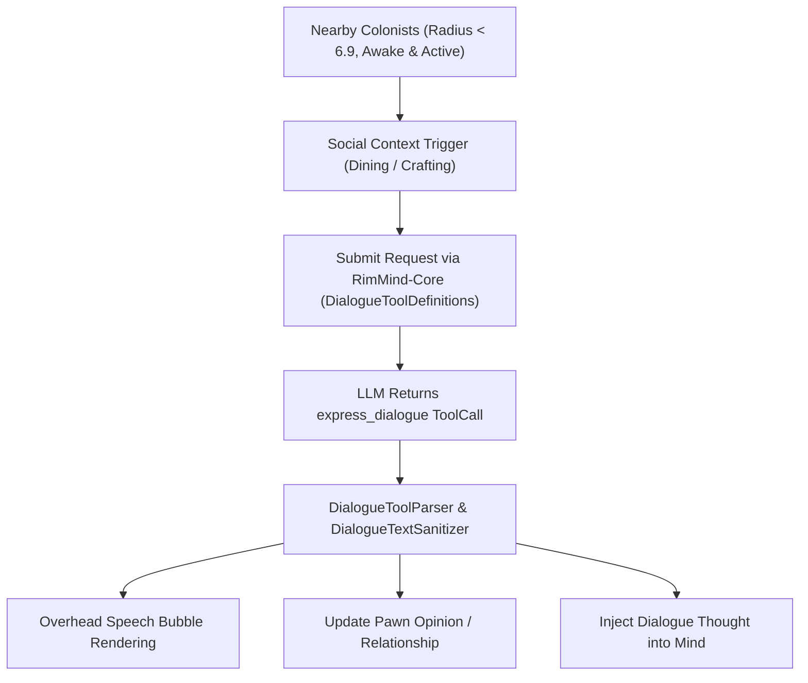

<div align="center">

# RimMind-Dialogue 💬
### Contextual Social Dialogue, Native Spoken ToolCalls & Overhead Bubbles for RimWorld 1.6 & 1.7

**English** | [简体中文](README_zh.md)

<p>
  <a href="https://rimworldgame.com/"></a>
  <a href="https://github.com/RimWorld-RimMind-Mod/RimWorld-RimMind-Mod-Core"></a>
  <a href="#"></a>
  <a href="LICENSE"></a>
</p>

<p><em>Imbue your colonists with spontaneous, context-aware conversations, natural banter, and evolving relationships.</em></p>

</div>

---

## 📖 Overview

**RimMind-Dialogue** brings RimWorld colonists to life through organic, natural spoken interactions. Powered by the native `express_dialogue` function call architecture, colonists talk to each other while eating in dining halls, laboring at craft benches, or resting by campfires.

### Core Capabilities
- **Native `express_dialogue` ToolCall (`DialogueToolDefinitions` & `DialogueToolParser`)**: Transmits spoken dialogue (`reply`), internal psychological subtext (`thought`), and relationship delta modifiers (`relation_delta: [-5, 5]`) as structured function parameters via `DialogueToolDefinitions.ExpressDialogue`, parsed deterministically by `DialogueToolParser` with dual-mode tool call and fallback support.
- **Dialogue Bubble Anti-Pollution & Sanitization Pipeline (`DialogueTextSanitizer`)**: Multi-stage sanitization strips `<think>` reasoning blocks, markdown code fences, raw JSON/XML fragments, and prompt metadata before any bubble or dialogue window renders, strictly blocking unparsed LLM artifacts from appearing over colonists' heads.
- **Contextual Spoken Triggers & Liveness Gating**: Conversational opportunities trigger organically based on physical proximity (radius 6.9 tiles), shared activities, and mutual social opinions, strictly guarded by `RimMindPawnLookup` liveness and consciousness checks so downed, sleeping, or off-map pawns never speak.
- **Dynamic Relationship Evolution**: Conversations dynamically impact mutual pawn opinions, fostering deep romances, bitter rivalries, or lasting camaraderie.
- **Smooth Overhead Speech Bubbles**: Renders text motes directly above colonists' heads with word wrapping and gentle fading animations.

---

## 🎮 In-Game Showcase


*Overhead spoken dialogue in the dining hall: Colonists share natural banter over a meal, with speech bubbles and live opinion adjustments.*

---

## 🏛️ Architecture & Dialogue ToolCall Flow



---

## 🛠️ Installation & Load Order

```text
1. Harmony
2. Core (Vanilla RimWorld)
3. RimMind-Core
4. RimMind-Dialogue
```

---

## 🧪 Developer Guide & Testing

Run unit tests covering `express_dialogue` tool call parsing, `DialogueTextSanitizer` anti-pollution filtering, and opinion delta boundaries (113 test cases):

```powershell
dotnet test RimMind-Dialogue/Tests/RimMindDialogue.Tests.csproj -c Release
```

---

## 📜 License

Licensed under the [MIT License](LICENSE).
